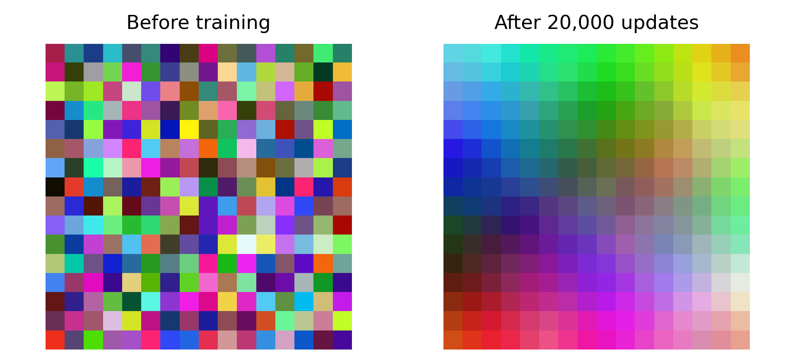
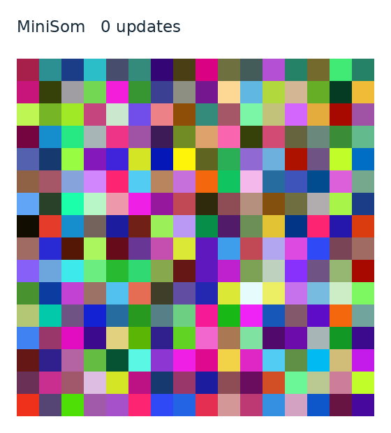

# Organizing Colors with MiniSom

A reproducible unsupervised learning experiment that organizes RGB colors on a
Self-Organizing Map (SOM). The project includes training, evaluation on separate
data, saved model weights, an animation, and the accompanying academic report.



## What the project does

Each input color is a vector of red, green and blue values in `[0, 1]`. MiniSom
learns a grid of representative colors without class labels. A training update
moves the closest prototype and its neighbors toward an input. Similar colors
gradually form smoother regions on the grid.

MiniSom provides the learning algorithm. NumPy generates and handles the data.
Matplotlib and Pillow export the figures and recorded training animation.

## Installation

Use Python 3.11 or newer. Python 3.12 is the reference environment.

### Windows CMD

Run these commands **inside the project folder**:

```bat
python -m venv .venv
.venv\Scripts\activate
python -m pip install -r requirements.txt
python main.py
```

### Linux or macOS

```sh
python3 -m venv .venv
source .venv/bin/activate
python -m pip install -r requirements.txt
python main.py
```

For an editable package installation and the `minisom-colors` command:

```sh
python -m pip install -e .
minisom-colors train
```

No dataset download or GPU is required.

## Run an experiment

The default command reproduces the experiment in the report:

```sh
python main.py
```

It trains for 20,000 updates and saves these files in `outputs/`:

| File | Contents |
| --- | --- |
| `before_after.png` | Actual model prototypes before and after training |
| `training.gif` | Recorded updates from the same training run |
| `map_before.png`, `map_after.png` | Individual prototype grids |
| `input_colors.png` | The generated training colors |
| `results.json` | Settings, package versions, evaluation metrics and query result |
| `color_map.npz` | Initial and learned weights, plus configuration metadata |

The default training settings are 1,000 training colors, 500 held-out evaluation
colors, a 16 by 16 map, sigma 2.0, learning rate 0.5 and random seed 42.

For a shorter experiment or a different map:

```sh
python main.py train --width 12 --height 12 --iterations 5000 --sigma 1.5
python main.py train --no-gif --output outputs/static
python main.py train --query 0.6 0.1 0.8
python main.py train --help
```

Each run replaces the generated files in its output directory. A run with
`--no-gif` removes an earlier `training.gif` there so that results stay consistent.

`iterations` counts individual updates, not full epochs. Animation frames are
recorded every 500 updates by default. The program always records the initial
and final states. `--frame-interval` changes the recording interval.

## Locate a new color using saved weights

```sh
python main.py locate --model examples/color_map.npz --rgb 1 0 0
```

The command prints the closest cell's zero-based row and column, its RGB
prototype, and its Euclidean distance from the query. To query your own trained
model, change the path to `outputs/color_map.npz`.

The published model places pure red at `(15, 2)`. Its prototype is approximately
`[0.914, 0.132, 0.185]`. These are coordinates and learned RGB values, not class
names.

## Recorded results

Both evaluations use the same 500 colors, separate from the 1,000 training colors.

| Metric | Before training | After training |
| --- | ---: | ---: |
| Topographic error | 97.6% | 9.2% |
| Quantization error | 0.096195 | 0.091848 |

**Topographic error** is the fraction of inputs whose two closest prototypes are
not neighboring cells. Lower values indicate better neighborhood consistency.

**Quantization error** is the mean Euclidean RGB distance from each input to its
closest prototype. A smaller value indicates more accurate reconstruction in
this RGB space.

Neither metric is classification accuracy. This is one demonstration run on
synthetic colors. Different seeds and settings can change the map's orientation
and its metrics. RGB distance is a convenient teaching example rather than a
perceptually uniform model of human color similarity.

### Training animation



The animation records the actual prototypes during training. The code does not
sort the learned colors afterward. Open the GIF directly for a classroom demo
without installing Python.

## Notebook

Open [demo.ipynb](demo.ipynb) for a short walkthrough using the same project code.
Install Jupyter separately if you want to run it locally:

```sh
python -m pip install notebook
jupyter notebook demo.ipynb
```

## Report and presentation

| Document | File |
| --- | --- |
| Report ready for submission | [MiniSom_Report.pdf](docs/MiniSom_Report.pdf) |
| Editable report | [MiniSom_Report.docx](docs/MiniSom_Report.docx) |

## Project files

| Path | Purpose |
| --- | --- |
| `main.py` | Convenient entry point from the project folder |
| `minisom_colors/experiment.py` | Configuration, training, evaluation and color lookup |
| `minisom_colors/artifacts.py` | Figures, animation and weight storage |
| `minisom_colors/cli.py` | Training and saved-model commands |
| `tests/test_project.py` | Behavioral checks and published-result regression |
| `examples/` | Reproducible reference results and trained weights |
| `docs/` | Report, presentation and speaking guide |
| `.github/workflows/ci.yml` | Tests on Linux and Windows with Python 3.11 and 3.12 |

## Tests

```sh
python -m unittest discover -s tests -v
```

The checks cover the reported metrics, reproducibility, separation of evaluation
data, saved-model queries, invalid inputs, animation observation, exported files
and command line behavior. The animation observer delegates every learning
update to MiniSom and is checked against training without recording.

## Sources and license

- [MiniSom repository and README](https://github.com/JustGlowing/minisom)
- [MiniSom implementation and evaluation methods](https://github.com/JustGlowing/minisom/blob/master/minisom.py)
- [Official MiniSom examples](https://github.com/JustGlowing/minisom/tree/master/examples)

Author: **Mohammad Azimi**. Prepared for Practical task 3, Intelligent Systems.

The project code is available under the [MIT License](LICENSE). Third-party
dependencies retain their respective licenses. University artwork in the report
cover is retained from the supplied academic template and is excluded from the
software license.
